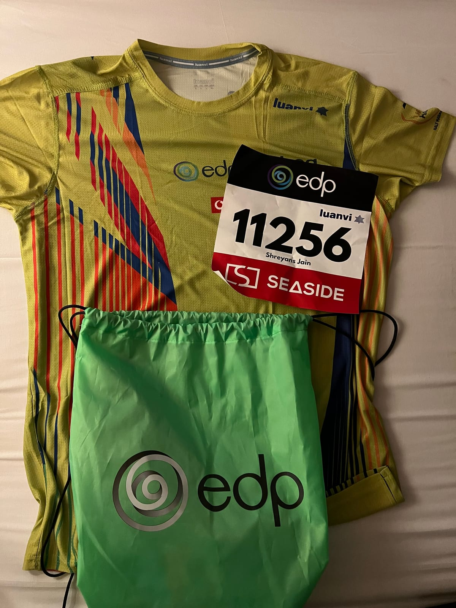
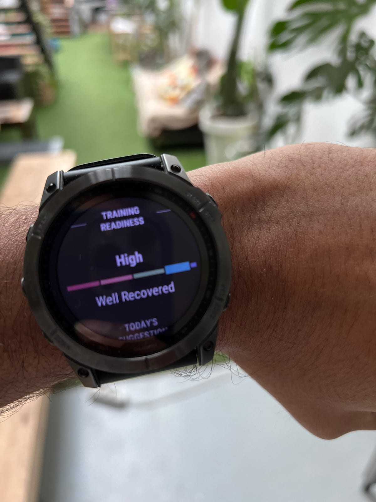
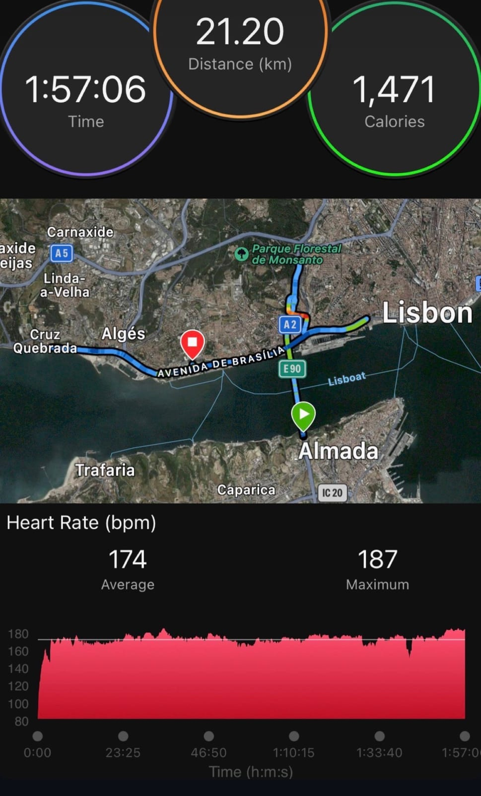
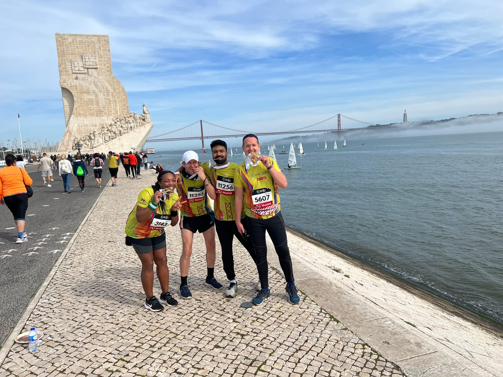

In 2022 I was going through a rough patch, and I picked up David Goggins'
*Can't Hurt Me*. I finished it wanting to do something hard, so I started
running.

## The first runs

They were brutal. I could barely run a kilometre or two without stopping.
That was the point, though: Goggins writes about doing the things you don't
want to do, and I didn't want to do this at all.

## When it stopped being a chore

There wasn't one run where it clicked. One day I just noticed I was looking
forward to it. A few things had crept up on me:

- **Progress I could see.** Every few weeks I could run a bit further or a
  bit faster, and the numbers on my watch proved it.
- **Being outside.** Running gets you out of the house and into the city
  in a way nothing else does.
- **Proving something to myself.** Running a distance that had felt
  impossible a few months before never got old.

## Lisbon, 2023

My first half marathon was the EDP Lisbon Half Marathon, on 12 March 2023.
The goal was sub-2:00.

The course starts in Almada, crosses the 25 de Abril bridge into Lisbon and
follows the river to Belém.

I remember the start: the nerves and the crowd. The hard part came around
km 15 to 18, when my legs started to go and every kilometre felt longer than
the last. I held on and finished in **1:57:06**.

I ran it in the Nike Alphafly NEXT%, which I'd also trained in. It's fast
and bouncy, and you can feel the plate and the foam doing some of the work.

## And then I stopped

Right after Lisbon, work got busy, and running stopped. Not slowly: one busy
stretch and it was gone, for about three years.

## The cookie jar

The idea from *Can't Hurt Me* that stuck with me most is the cookie jar:
when things get hard, you reach back for the hard things you've already
done and remind yourself you got through them. I still believe in it.

Lisbon is in my jar now. When a run feels bad, I remember km 15 to 18 and
that I didn't stop.

## Starting again

This time I've got a new pair of shoes and a new way of keeping myself
honest.

The shoes are the Puma Fast-R Nitro Elite 3. I bought them to try something
other than Nike. Honestly? So far I still prefer the Alphafly.

The new way of keeping myself honest is this blog. Writing in public means
that if I stop again, it will show.
