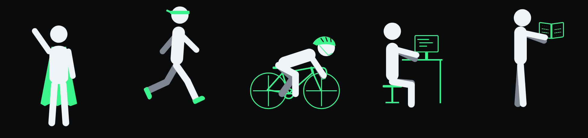
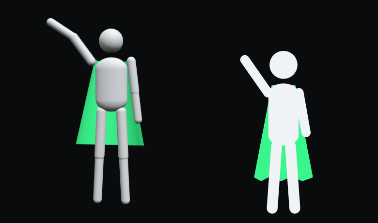

import Anatomy from '../../components/post/Anatomy.astro';
import CommitChart from '../../components/post/CommitChart.astro';
import Expand from '../../components/post/Expand.astro';
import ExpandAll from '../../components/post/ExpandAll.astro';
import PlanDiff from '../../components/post/PlanDiff.astro';
import ScrollDemo from '../../components/post/ScrollDemo.astro';
import StatStrip from '../../components/post/StatStrip.astro';
import Term from '../../components/post/Term.astro';
import TwoClaudes from '../../components/post/TwoClaudes.astro';



This site is a <Term t="static">static</Term> blog with an animated homepage.
I didn't write its code. I described what I wanted, Claude Code wrote it, and
I said yes, no, or "make the cape smoother". This post covers what each part
of the site is, why it was picked, how I worked with Claude Code, and the
shortest path from a blank MacBook to a live site.

<StatStrip
	stats={[
		{ value: '11 days', label: 'first chat to this post' },
		{ value: '47', label: 'commits before this post' },
		{ value: '1', label: 'dependency added' },
		{ value: '97 KB', label: 'homepage size' },
		{ value: '97–100', label: 'Lighthouse scores' },
	]}
/>

Dotted words have a definition: tap them. Code and longer explanations are
folded away; open what interests you.

<ExpandAll />

## The anatomy of this website

A website is a few layers, and most of them are invisible. Hover over a part,
or tap it on a phone, to see what it does, what I picked and why.

<Anatomy />

The short version: posts are <Term t="markdown">Markdown</Term> files, Astro
<Term t="build">builds</Term> them into plain files, GitHub stores the code,
and Vercel sends the files to visitors from a <Term t="cdn">CDN</Term>.
There's no server running code and no database, so there's nothing to keep
running or patch.

## The figure

The homepage figure is made of plain shapes: rounded rectangles for the body,
<Term t="svg">SVG</Term> drawings for the bike, desk, book and brain. A
library called GSAP watches how far down the page you've scrolled and sets
the figure's pose to match.

The core idea fits in one sentence: scroll position is one number between 0
and 1, and every joint angle is worked out from it. Try it:

<ScrollDemo />

The real figure does this for about twenty values at once (every joint, plus
where it stands and which props are visible), across five scenes.

<Expand kind="deep" title="Two layers per joint" time="1 min" teaser="How the scroll pose and the running motion avoid fighting each other.">

Scroll sets the pose. But in some scenes the figure also moves on its own:
legs stride while running, feet pedal on the bike, hands type at the desk.
Those loops play on a timer, not with your scroll.

If both wrote to the same joint, one would overwrite the other. So every joint
is two nested elements. The outer one gets the pose from scroll; the inner one
gets the loop's small extra swing on top. A loop only plays while its scene is
on screen, and resets its inner layer to zero when it stops.

The bug that led to this: GSAP applies an animation's starting values the
moment it's created, unless you tell it not to (`immediateRender: false`).
For a while every scene had bent knees, because the running loop had quietly
set them on page load.

</Expand>

<Expand kind="deep" title="Feet that stay on the pedals" time="1 min" teaser="Inverse kinematics, in two lines of trigonometry.">

When cycling, the pedal goes round in a circle and the foot has to stay on
it. Instead of setting hip and knee angles by hand, the code knows where the
foot must be and works backwards to the angles. That's called
<Term t="ik">inverse kinematics</Term>.

With two bones (thigh and shin) and a known distance from hip to pedal, the
knee angle comes from the law of cosines. Then the hip angle is the direction
to the pedal, corrected for the bent knee. That runs every frame, about sixty
times a second.

</Expand>

The plan was a 3D figure, built with Three.js. Claude Code built it in one
evening on a separate <Term t="branch">branch</Term>, with all five scenes,
lighting and a real turn of the body. I looked at it next to the 2D one and
kept the 2D one.



Building something just to throw it away sounds wasteful. Here it was a
cheap way to decide: one evening of the agent's time, and then I could compare
the two side by side. The 3D version would also have added about 600 KB to a homepage
that's 97 KB now.

## What I planned vs what shipped

Most of the plan changed once it met a real screen.

<PlanDiff />

## How I worked with Claude Code

I used two Claudes. In the claude.ai app I talked through ideas and made
decisions. Claude Code, in the <Term t="terminal">terminal</Term>, did the
building: it reads the code, edits files, runs the build and pushes to GitHub.
The two can't see each other. The only link is a file in the
<Term t="repo">repo</Term>.

<TwoClaudes />

`docs/plan.md` holds the roadmap, the decisions and a log of every time the
build departed from the plan. Claude Code updates it after each step. One
lesson: when I asked the claude.ai project to review it while writing this
post, it was reading a copy from before most of the build, with seven steps
and none ticked. A shared file only works if both sides see the latest copy.

What made the biggest difference:

- **Standing rules.** A `CLAUDE.md` file is read at the start of every
  session. Mine says: explain every change and the reasoning, ask before adding
  a dependency, one branch per roadmap step, never push without being asked,
  and open preview links in my browser.
- **A <Term t="preview">preview</Term> for every step.** Each step got a
  branch; Vercel built a private copy of the site for it; I looked; then it was
  merged.
- **Checking its own work.** Before showing me a layout, Claude Code took
  screenshots with a headless browser (Chrome without a window) at phone,
  tablet and desktop sizes. The images in this post were made the same way.
- **A second agent in parallel.** Analytics was built by another agent in its
  own copy of the repo while the first one was still polishing the homepage.
- **A second model as reviewer.** When I said the bike proportions looked
  weird, a different Claude model (Fable) reviewed them: road-bike wheel size,
  a head tube, a fork that leans forward. The bike looks like a bike now.
- **Permissions.** A settings file lists what it can do without asking:
  build, run the dev server, read the git history, open links, and push.
  Anything else needs a yes.

<Expand title="show the permissions file">

```json
{
  "permissions": {
    "allow": [
      "Bash(npm run build)",
      "Bash(npm run preview)",
      "Bash(npx astro dev *)",
      "Bash(git status *)",
      "Bash(git diff *)",
      "Bash(git log *)",
      "Bash(open https://*)",
      "Bash(git push *)"
    ]
  }
}
```

</Expand>

Advice I got and didn't use: plan mode, hooks, custom skills, and a cheaper
model for routine edits. The site got built without them.

## The numbers

<CommitChart />

Eleven days from my first question to this post, but most of the building
happened in one evening: 34 of the 47 commits are from 16 October.

Claude Code works in <Term t="token">tokens</Term>. Over the whole project it
wrote about 370,000 of them (code, explanations, commands) and re-read about
121 million. That's roughly 330 tokens read for every token written: an agent
spends most of its effort re-reading the conversation and the code, not
writing. Most of that re-reading comes from a cache, which is much cheaper
than reading fresh.

Google's Lighthouse scores the homepage 97 for performance on a simulated slow
phone, and 100 for accessibility, best practices and SEO.

## From a blank MacBook to a live site

Seven steps. Each has the exact commands folded underneath.

1. **Install Homebrew**, which installs other software for you. It also
   installs Apple's command line tools, which include git.

<Expand title="show the command">

```sh
/bin/bash -c "$(curl -fsSL https://raw.githubusercontent.com/Homebrew/install/HEAD/install.sh)"
```

</Expand>

2. **Install Node and the GitHub command line.** Node runs Astro's build
   tools; it never runs on the live site.

<Expand title="show the command">

```sh
brew install node gh
node -v   # should be 22 or newer
```

</Expand>

3. **Make a GitHub account** at github.com, then log in from the terminal.

<Expand title="show the command">

```sh
gh auth login
```

</Expand>

4. **Start from Astro's blog template** and run it on your Mac.

<Expand title="show the command">

```sh
mkdir -p ~/dev && cd ~/dev
npm create astro@latest my-website -- --template blog
cd my-website
npm run dev   # open http://localhost:4321
```

</Expand>

5. **Put it on GitHub.**

<Expand title="show the command">

```sh
git init -b main   # skip if the installer already made a repo
git add -A
git commit -m "Start from the Astro blog template"
gh repo create my-website --public --source=. --push
```

</Expand>

6. **Connect Vercel.** Sign up at vercel.com with your GitHub account, choose
   *Add New → Project*, import the repo and press *Deploy*. A minute later you
   have a live link, and every push <Term t="deploy">deploys</Term> again.

7. **Install Claude Code** and let it learn your project.

<Expand title="show the command">

```sh
curl -fsSL https://claude.ai/install.sh | bash
cd ~/dev/my-website
claude   # then type /init inside it
```

</Expand>

<Expand kind="deep" title="Mistakes I made on the way" time="1 min" teaser="So you don't have to.">

- **Keep projects out of `~/Documents`.** iCloud tries to sync it, including
  the thousands of files in `node_modules`. Use a folder like `~/dev`.
- **Don't paste a long list of commands at once.** One of mine deleted some
  files and zsh asked "are you sure?". That question swallowed the rest of the
  paste.
- **Your commit email is public** in a public repo. GitHub gives you a
  no-reply address to use instead.
- **Minifiers can rewrite your CSS.** One shortened an animation rule into
  `animation: none`. Writing it out in full fixed it.

</Expand>

## Questions I asked along the way

I'm new to this. These are real questions from my chats, lightly tidied.

<Expand kind="deep" title="Should I move from the web chat to the terminal?">

For building, yes. Claude Code can read and edit the files, run the build and
see the errors itself. I kept the web chat for design discussions.

</Expand>

<Expand kind="deep" title="What is Vercel for?">

It takes the code from GitHub, builds the site every time you push, and
serves it from servers around the world. It also gives every branch its own
preview link.

</Expand>

<Expand kind="deep" title="Is Node a backend?">

Not here. Node runs once on my Mac or on Vercel to build the site. Visitors
only ever get the finished files.

</Expand>

<Expand kind="deep" title="Wouldn't making my email address public cause spam?">

Every git commit carries an email address, and in a public repo anyone can
see it. GitHub gives you a private no-reply address for commits.

</Expand>

<Expand kind="deep" title="Why is deleting branches necessary?">

It isn't. Once a branch is merged, it's just a label; deleting it loses
nothing. It keeps the list short.

</Expand>

<Expand kind="deep" title="Is GSAP an alternative to Three.js, or do we use both?">

They do different jobs. Three.js draws 3D scenes; GSAP changes values over
time or with scroll. You can use them together. This site ended up needing
only GSAP.

</Expand>

<Expand kind="deep" title="What are hooks?">

Scripts Claude Code runs automatically at set moments, like before a command
or when a session starts. Rules in `CLAUDE.md` are advice the model follows;
hooks always run.

</Expand>

<Expand kind="deep" title="What is Lighthouse?">

A tool built into Chrome that scores a page on speed, accessibility, good
practice and search-engine friendliness, and lists what to fix.

</Expand>

<Expand kind="deep" title="Can we read visitors' cookies to see which other sites they visited?">

No. A site can only read its own cookies; browsers block everything else on
purpose. This site uses no cookies at all.

</Expand>

## What's next

A custom domain, maybe a newsletter, and posts on the other topics: running,
biking, psychology, quant trading and finance.

---

*I chose what went into this post. Claude Code drafted it from my notes, the
git history and my chats with Claude.*
